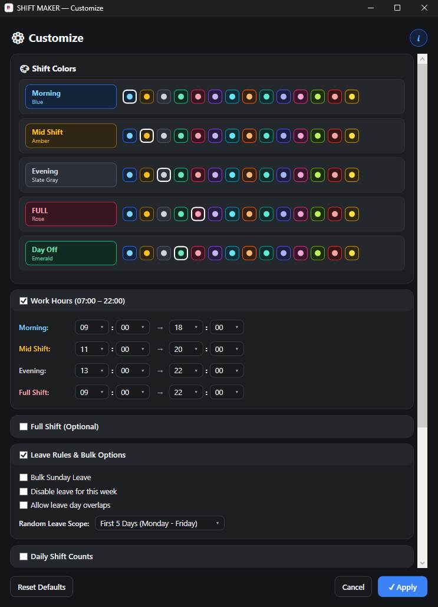
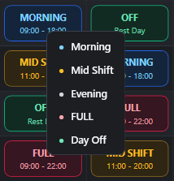

# SHIFT MAKER

[Türkçe](#turkce) | [English](#english)

---

| in App View | App Costumize | Shift Customize | Output Result |
|---|---|---|---|
|  |  |  |  |

---

<a name="turkce"></a>
## Türkçe

Haftalık shift programı oluşturucu. Mağaza, ofis veya ekip için seçtiğiniz herhangi bir başlangıç gününden itibaren **7 günlük** otomatik, adil ve özelleştirilebilir shift planı hazırlar.

<p align="left">
  <a href="https://github.com/c4brky/SHIFT-APP/releases/latest/download/shiftmaker.exe">
    
  </a>
</p>

> [!WARNING]
> Windows SmartScreen **"Bilinmeyen uygulama"** uyarısı verebilir. Uygulama dijital olarak imzalanmadığı için bu uyarı normaldir; bir virüs değildir ve kaynak kodu tamamen açıktır.

> [!TIP]
> **Nasıl Açılır?** Uyarı penceresinde **"Ek bilgi"** yazısına tıklayıp **"Yine de çalıştır"** butonuna basarak programı güvenle başlatabilirsiniz. *(İsterseniz indirilen `.exe` dosyasına Sağ Tık → Özellikler → **Engeli kaldır** diyerek uyarıyı kalıcı olarak kapatabilirsiniz.)*

### Özellikler

- **3–30 kişi** arası ekip desteği ve ekibe göre ölçeklenen günlük shift sayıları
- **Sabahçı / Ara Shift / Akşamcı / Full / İzin** shift tipleri
- **14 hazır renk paleti** ile tüm shift tiplerinin renklerini özelleştirme
- **Dinamik tarih aralığı**: Haftanın herhangi bir gününden başlayan 7 günlük plan seçimi
- **Tablo üzerinden tıklayarak düzenleme**: Oluşturulan shift hücrelerine tıklayıp manuel değişiklik yapabilme
- **Çift dil (TR / EN)** desteği
- Renkli, paylaşılabilir **PNG / JPG** görsel çıktı
- Haftalık izin ataması (rastgele / belirli gün / toplu izin) ve ilk gün rastgele izinde önceki shiftin son günündeki sabahçıyı dikkate alma kuralı
- **Adalet algoritması** ve **önceki 2 hafta** karşılaştırması
- **Full kalma**: İsteğe bağlı, gün gün kişi seçimi
- **Mesai saatleri**: Özelleştirilebilir (07:00 – 22:00, 15 dk aralık)
- **Otomatik kayıt & Geçmiş**: Tek tıkla geçmişe erişim ve tüm geçmişi temizleme

### Kurulum

> [!NOTE]
> **Hazır Exe (Önerilen):** **Releases** bölümünden veya yukarıdaki **DOWNLOAD** butonundan `shiftmaker.exe` dosyasını indirip doğrudan çift tıklayarak çalıştırabilirsiniz. **.NET Runtime gömülüdür**, ek kurulum veya internet bağlantısı gerektirmez.

---

<a name="english"></a>
## English

Weekly shift schedule generator. Creates an automated, fair, and customizable **7-day** shift plan starting from any day of the week for your store, office, or team.

<p align="left">
  <a href="https://github.com/c4brky/SHIFT-APP/releases/latest/download/shiftmaker.exe">
    
  </a>
</p>

> [!WARNING]
> Windows SmartScreen may show an **"Unknown publisher"** warning because the binary is not code-signed. This is expected; the source code is completely open.

> [!TIP]
> **How to Run:** Click **"More info"** and then **"Run anyway"**. *(Optionally, right-click the `.exe` → Properties → **Unblock** to disable the prompt permanently.)*

### Features

- **3–30 staff** support with proportional daily Morning & Mid shift count options
- **Morning / Mid Shift / Evening / Full / Day Off** shift types
- **14 curated color presets** to customize every shift type's color
- **Dynamic date range**: Pick any start date for a 7-day schedule (Monday–Sunday or any international week cycle)
- **Click-to-edit cells**: Click any generated shift cell in the table to manually change it
- **Bilingual (TR / EN)** interface and exports
- Shareable **PNG / JPG** image export
- Smart leave assignment (random / fixed day / bulk) with cross-week Day-1 random leave priority for the previous shift's last-day Morning worker
- **Fairness algorithm** and **last 2 weeks** similarity prevention
- **Full shift** optional per-day assignment and **customizable work hours** (07:00 – 22:00, 15-min steps)
- **Auto-save & History** with one-click clear all history

### Setup

> [!NOTE]
> **Ready-to-use Exe (Recommended):** You can download the `shiftmaker.exe` file from the **Releases** section or by clicking the **DOWNLOAD** button above, then simply double-click it to run. The **.NET Runtime is embedded**, so no additional installation or internet connection is required.

---

### Project Structure

```text
├── assets/                       # README screenshots and download button
├── src/shift_maker/              # Main WPF application
│   ├── models/                   # Data models
│   ├── services/                 # Generator, persistence, localization, palette, image export
│   ├── views/                    # Customization window
│   ├── helpers/                  # Windows theme helpers
│   ├── themes/                   # XAML theme and style dictionaries
│   └── assets/                   # App logo and icon
└── shift_maker.sln               # Solution file
```

### License

MIT

---

*created by c4brky*
