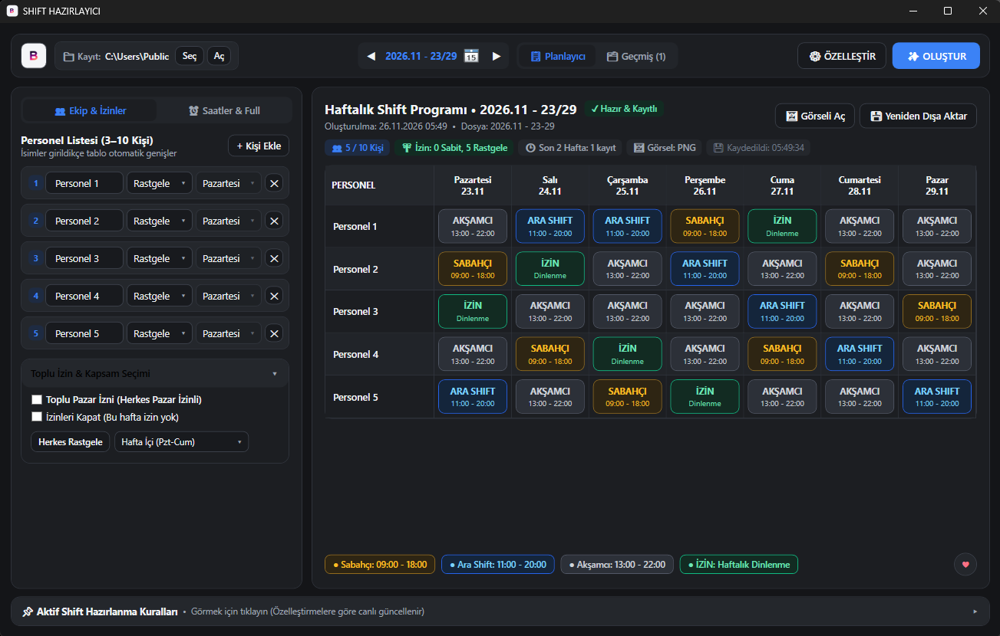
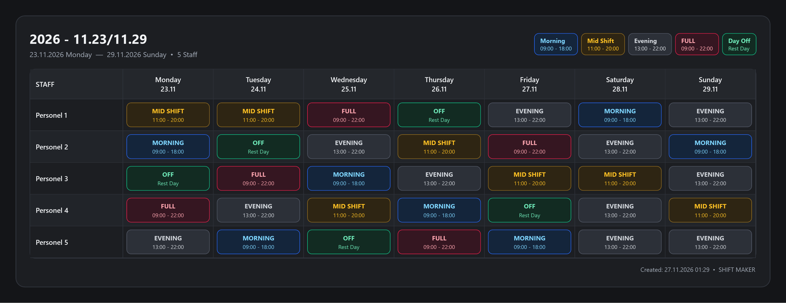

<p >
  <a href="https://github.com/c4brky/SHIFT-APP/releases/latest/download/shift_hazirlayici.exe">
    
  </a>
</p>

## Ekran Görüntüleri
⚠️ Windows SmartScreen "Bilinmeyen uygulama" uyarısı verebilir. Bu bir virüs değildir, uygulama imzasız olduğu için çıkar. "Ek bilgi" → "Yine de çalıştır"</b> ile güvenle açabilirsiniz. Kaynak kodu tamamen açıktır, inceleyebilirsiniz.

| Uygulama Arayüzü | Shift Sonucu |
|---|---|
|  |  |

# Shift Hazırlayıcı

Haftalık shift programı oluşturucu. Mağaza, ofis veya ekip için **Pazartesi–Pazar** arası otomatik, adil ve özelleştirilebilir shift planı hazırlar.

## Özellikler

- **3–10 kişi** arası ekip desteği
- **Sabahçı / Ara Shift / Akşamcı / Full / İzin** shift tipleri
- Renkli, paylaşılabilir **PNG / JPG** görsel çıktı
- Haftalık izin ataması (rastgele / belirli gün / toplu Pazar)
- **Adalet algoritması**: Sabah + Ara shift eşit dağıtılır
- **Önceki 2 hafta** kontrol edilerek tekrar önleme
- Full kalma: isteğe bağlı, gün gün kişi seçimi
- Mesai saatleri tamamen özelleştirilebilir (07:00 – 22:00, 15 dk aralık)
- Otomatik kayıt (her kapanışta ayarlar saklanır)
- Geçmiş shift kayıtlarına tek tıkla erişim
- Antrasit koyu tema, modern Windows 11 tasarımı

## Gereksinimler

### Kaynak Koddan Derleme
- .NET 8 SDK (`net8.0-windows`)
- Windows 10 / 11

### Exe (Hazır Çalıştırılabilir)
- Hiçbir ek kurulum gerekmez — .NET Runtime gömülüdür
- İnternet bağlantısı gerekmez
- `release/` klasöründeki `shift_hazirlayici.exe` dosyasını çift tıklayarak çalıştırabilirsiniz

## Proje Yapısı

```
├── assets/                       # Gereklilikler (SVG)
├── src/ShiftHazirlayici/         # Ana uygulama (WPF)
│   ├── Models/                   # Veri modelleri
│   ├── Services/                 # Shift üretici, kayıt, görsel dışa aktarma
│   ├── Views/                    # Özelleştirme penceresi
│   ├── Helpers/                  # Windows tema yardımcıları
│   ├── Themes/                   # XAML tema ve stil dosyaları
│   └── Assets/                   # Logo ve ikon
└── ShiftHazirlayici.sln          # Solution dosyası
```

## Lisans

MIT

---

*created by c4brky*
